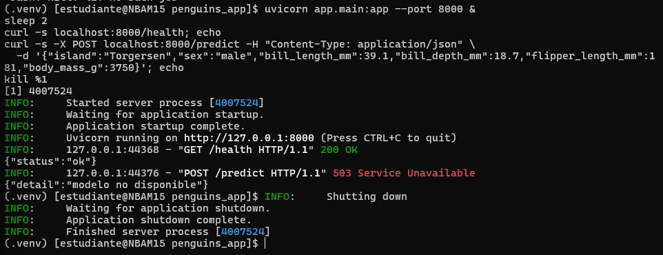
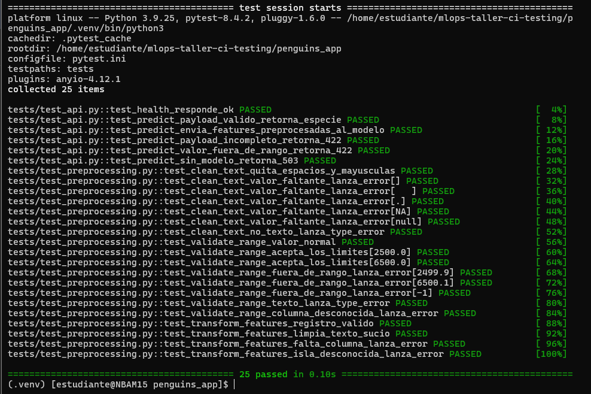
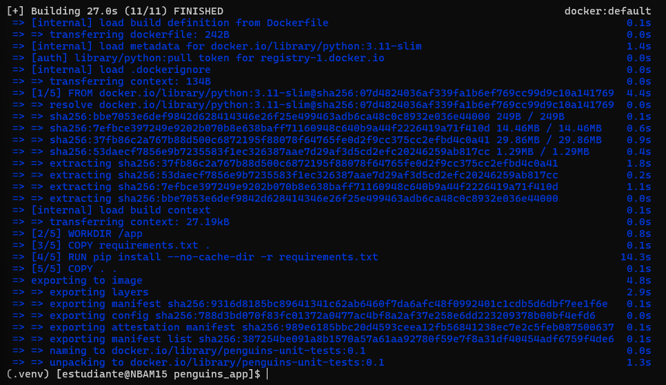
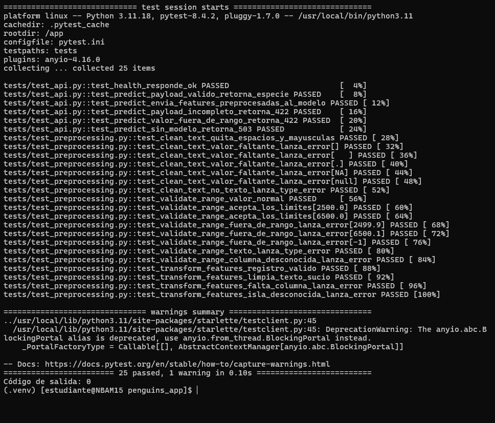

cd ~/mlops-taller-ci-testing/penguins_app
cat > README.md << 'EOF'
# Actividad 1 · Pruebas unitarias con pytest — Penguins API

Módulo de preprocesamiento para el dataset Palmer Penguins, expuesto en una API con FastAPI,
probado con pytest y ejecutado dentro de un contenedor Docker.

## Estructura

```text
penguins_app/
  app/
    preprocessing.py   # 3 funciones de preprocesamiento
    main.py            # API FastAPI (/health, /predict)
  tests/
    conftest.py        # fixtures: pingüino válido, FakeModel, cliente de pruebas
    test_preprocessing.py
    test_api.py
  penguins_app/evidencias/          # capturas de la ejecución
  pytest.ini
  requirements.txt
  Dockerfile
```

## Funciones de preprocesamiento

| Función | Qué hace | Cuándo falla |
|---|---|---|
| `clean_text` | Quita espacios sobrantes y pasa a minúsculas (`"  Biscoe "` → `"biscoe"`) | Si no es texto (`TypeError`) o es un faltante como `""`, `"."`, `"NA"` (`ValueError`) |
| `validate_range` | Revisa que una medida esté dentro de un rango razonable | Columna desconocida, valor no numérico o fuera de rango |
| `transform_features` | Convierte un registro en los 9 números que recibe el modelo: 4 medidas, isla en one-hot, sexo 0/1 y `bill_ratio` (largo/profundidad del pico) | Si falta una columna, o la isla o el sexo no son válidos |

Los rangos se definieron a partir de los mínimos y máximos observados en el dataset,
con un pequeño margen, para rechazar errores de captura sin descartar individuos reales.

## API

- `GET /health` → `{"status": "ok"}`
- `POST /predict` → especie predicha. Responde **422** si los datos no son válidos y **503** si no hay modelo.

El modelo se entrega al endpoint mediante `Depends(get_model)`. En las pruebas se reemplaza
por un `FakeModel`, de modo que la API se puede probar sin un modelo entrenado.

## Pruebas (25 en total)

- **`test_preprocessing.py` (19):** casos normales, límites exactos de los rangos (bordes),
  valores fuera de rango, texto sucio, columnas faltantes y errores con `pytest.raises`.
  Se usa `@pytest.mark.parametrize` para probar varios valores sin repetir código.
- **`test_api.py` (6):** health check, predicción válida, que el modelo reciba las features ya
  preprocesadas, payload incompleto (422 por Pydantic), valor fuera de rango (422 por
  `validate_range`) y API sin modelo (503). Se usa `TestClient`, sin levantar el servidor.

## Cómo ejecutarlo

**Local:**
```bash
python3 -m venv .venv && source .venv/bin/activate
pip install -r requirements.txt
pytest -v
```

**En contenedor** (el Dockerfile ejecuta `pytest` automáticamente):
```bash
docker build -t penguins-unit-tests:0.1 .
docker run --rm penguins-unit-tests:0.1
```

## Evidencias

**1. Pruebas de preprocesamiento en la VM (19 passed)**


**2. Prueba fallando a propósito:** se cambió el límite de masa corporal de 6500 a 6000 g, y la prueba del límite exacto lo detectó.


**3. API corriendo con uvicorn:** `/health` responde 200 y `/predict` responde 503 porque no hay modelo real.


**4. Todas las pruebas en la VM (25 passed, Python 3.9)**


**5. Construcción de la imagen Docker**


**6. Pruebas ejecutadas dentro del contenedor (25 passed, Python 3.11, código de salida 0)**


