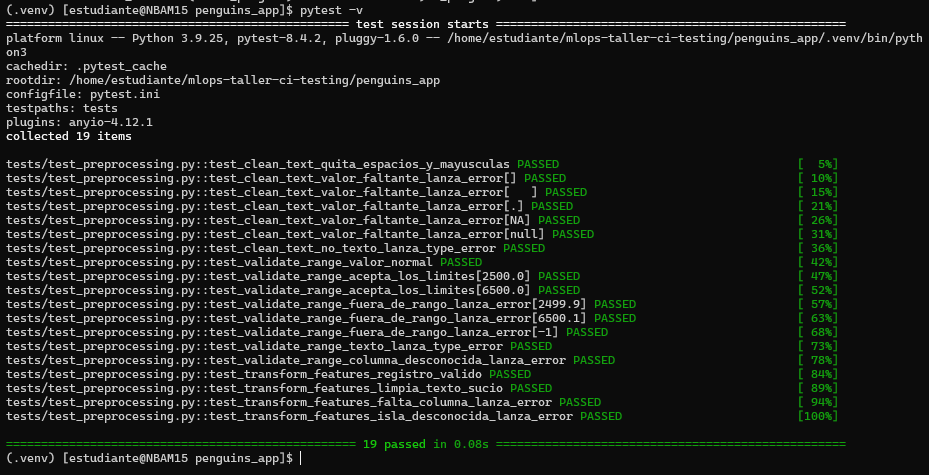
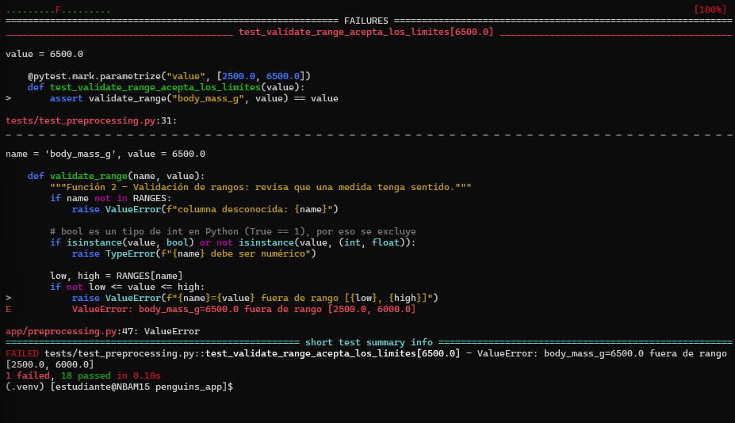
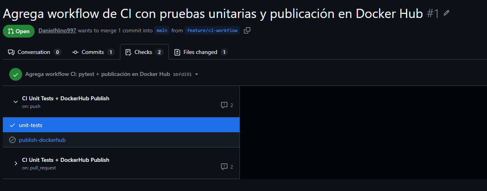
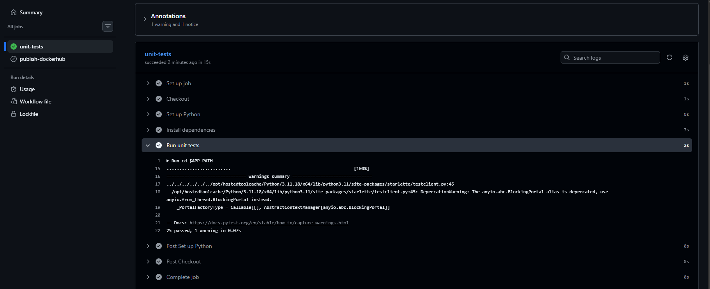
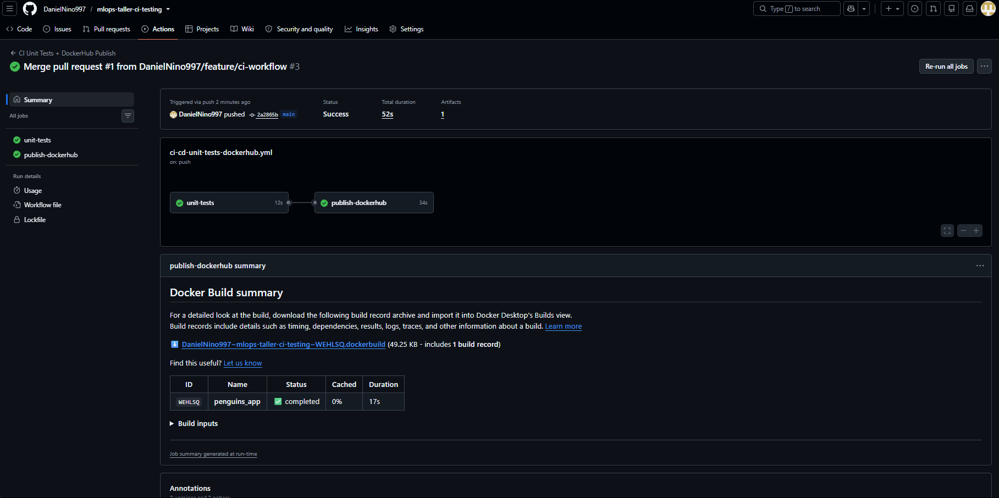
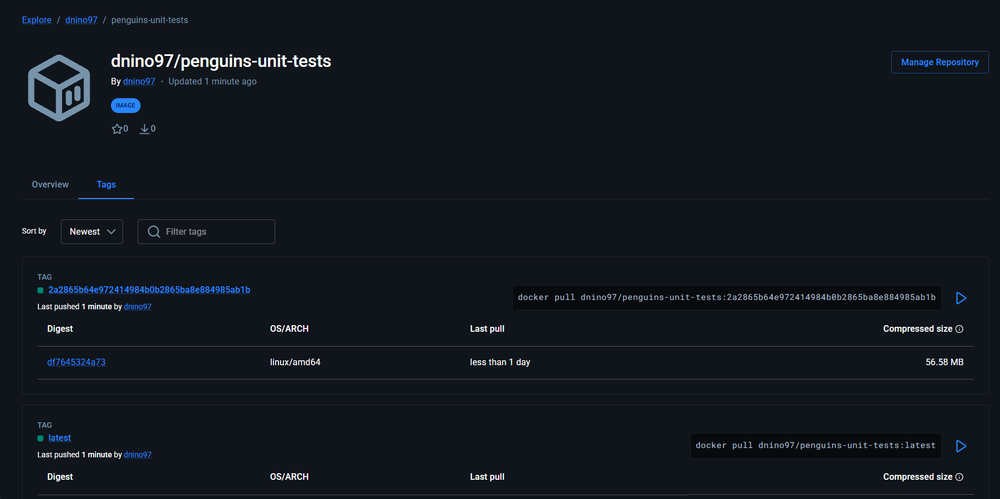
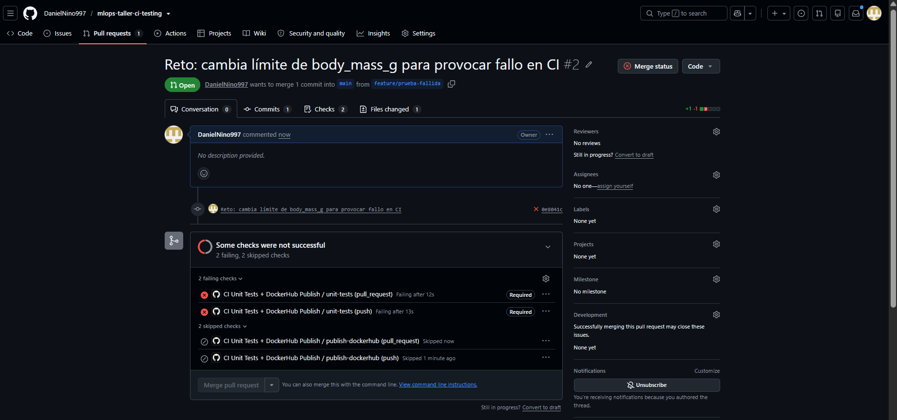
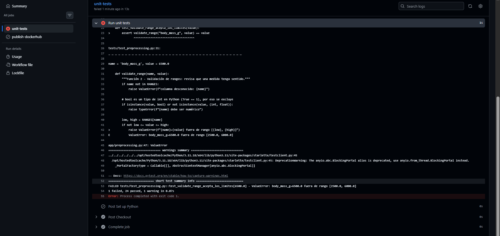

# Actividad 1 · Pruebas unitarias con pytest — Penguins API

Módulo de preprocesamiento para el dataset Palmer Penguins, expuesto en una API con FastAPI,
probado con pytest y ejecutado dentro de un contenedor Docker.

## Estructura

```text
mlops-taller-ci-testing/
  README.md
  penguins_app/
    app/
      preprocessing.py   # 3 funciones de preprocesamiento
      main.py            # API FastAPI (/health, /predict)
    tests/
      conftest.py        # fixtures: pingüino válido, FakeModel, cliente de pruebas
      test_preprocessing.py
      test_api.py
    evidencias/          # capturas de la ejecución
    pytest.ini
    requirements.txt
    Dockerfile
```

## Funciones de preprocesamiento

| Función | Qué hace | Cuándo falla |
|---|---|---|
| `clean_text` | Quita espacios sobrantes y pasa a minúsculas (`"  Biscoe "` → `"biscoe"`) | Si no es texto (`TypeError`) o es un faltante como `""`, `"."`, `"NA"` (`ValueError`) |
| `validate_range` | Revisa que una medida esté dentro de un rango razonable | Columna desconocida, valor no numérico o fuera de rango |
| `transform_features` | Convierte un registro en los 9 números que recibe el modelo: 4 medidas, isla en one-hot, sexo 0/1 y `bill_ratio` (largo/profundidad del pico) | Si falta una columna, o la isla o el sexo no son válidos |

Los rangos se definieron a partir de los mínimos y máximos observados en el dataset,
con un pequeño margen, para rechazar errores de captura sin descartar individuos reales.

## API

- `GET /health` → `{"status": "ok"}`
- `POST /predict` → especie predicha. Responde **422** si los datos no son válidos y **503** si no hay modelo.

El modelo se entrega al endpoint mediante `Depends(get_model)`. En las pruebas se reemplaza
por un `FakeModel`, de modo que la API se puede probar sin un modelo entrenado.

## Pruebas (25 en total)

- **`test_preprocessing.py` (19):** casos normales, límites exactos de los rangos (bordes),
  valores fuera de rango, texto sucio, columnas faltantes y errores con `pytest.raises`.
  Se usa `@pytest.mark.parametrize` para probar varios valores sin repetir código.
- **`test_api.py` (6):** health check, predicción válida, que el modelo reciba las features ya
  preprocesadas, payload incompleto (422 por Pydantic), valor fuera de rango (422 por
  `validate_range`) y API sin modelo (503). Se usa `TestClient`, sin levantar el servidor.

## Cómo ejecutarlo

**Local:**
```bash
cd penguins_app
python3 -m venv .venv && source .venv/bin/activate
pip install -r requirements.txt
pytest -v
```

**En contenedor** (el Dockerfile ejecuta `pytest` automáticamente):
```bash
cd penguins_app
docker build -t penguins-unit-tests:0.1 .
docker run --rm penguins-unit-tests:0.1
```

## Evidencias

**1. Pruebas de preprocesamiento en la VM (19 passed)**


**2. Prueba fallando a propósito:** se cambió el límite de masa corporal de 6500 a 6000 g, y la prueba del límite exacto lo detectó.


**3. API corriendo con uvicorn:** `/health` responde 200 y `/predict` responde 503 porque no hay modelo real.


**4. Todas las pruebas en la VM (25 passed, Python 3.9)**


**5. Construcción de la imagen Docker**


**6. Pruebas ejecutadas dentro del contenedor (25 passed, Python 3.11, código de salida 0)**


---

# Actividad 2 · GitHub Actions — CI con pytest y publicación en Docker Hub

Workflow: [`.github/workflows/ci-cd-unit-tests-dockerhub.yml`](.github/workflows/ci-cd-unit-tests-dockerhub.yml),
basado en la plantilla del curso, ajustando `paths`, `APP_PATH` e `IMAGE_NAME`.

**Imagen publicada:** https://hub.docker.com/r/dnino97/penguins-unit-tests/tags

## Cómo funciona

- **Disparadores:** `push` a `main` o a ramas `feature/**`, y `pull_request` hacia `main`, solo si cambia algo en `penguins_app/` o en el propio workflow (`paths`).
- **Job `unit-tests`:** clona el repo, instala Python 3.11 y las dependencias de `requirements.txt`, y ejecuta `pytest`. Si una prueba falla, pytest termina con código de salida 1 y el job queda en rojo.
- **Job `publish-dockerhub`:** depende de `unit-tests` (`needs`) y solo corre en un push a `main`, es decir, al hacer merge. Inicia sesión con los secretos `DOCKERHUB_USERNAME` y `DOCKERHUB_TOKEN`, construye la imagen y la publica con dos tags: `latest` y el SHA del commit, para poder rastrear qué código generó cada imagen.
- **Protección de rama:** `main` exige que `unit-tests` pase antes de permitir el merge, sin excepciones para administradores.

## Evidencias

**1. Pull Request #1: `unit-tests` en verde y `publish-dockerhub` omitido (en un PR no se publica)**


**2. Ejecución del job `unit-tests` en GitHub (25 passed, Python 3.11)**


**3. Merge a `main`: `unit-tests` → `publish-dockerhub`, disparado por push en el commit `2a2865b`**


**4. Imagen en Docker Hub con los tags `latest` y `2a2865b64e972414984b0b2865ba8e884985ab1b`**


## Reto: prueba fallida bloquea el merge

Se cambió a propósito el límite de `body_mass_g` de 6500 a 6000 en una rama `feature/prueba-fallida`.
La prueba de borde `test_validate_range_acepta_los_limites[6500.0]` falló, el job terminó con código 1,
y la regla de protección de `main` bloqueó el merge. El PR se cerró sin integrar y no se publicó ninguna imagen.

**PR #2 con los checks requeridos en rojo y el botón de merge deshabilitado**


**Log del job fallido (1 failed, 24 passed, exit code 1)**

